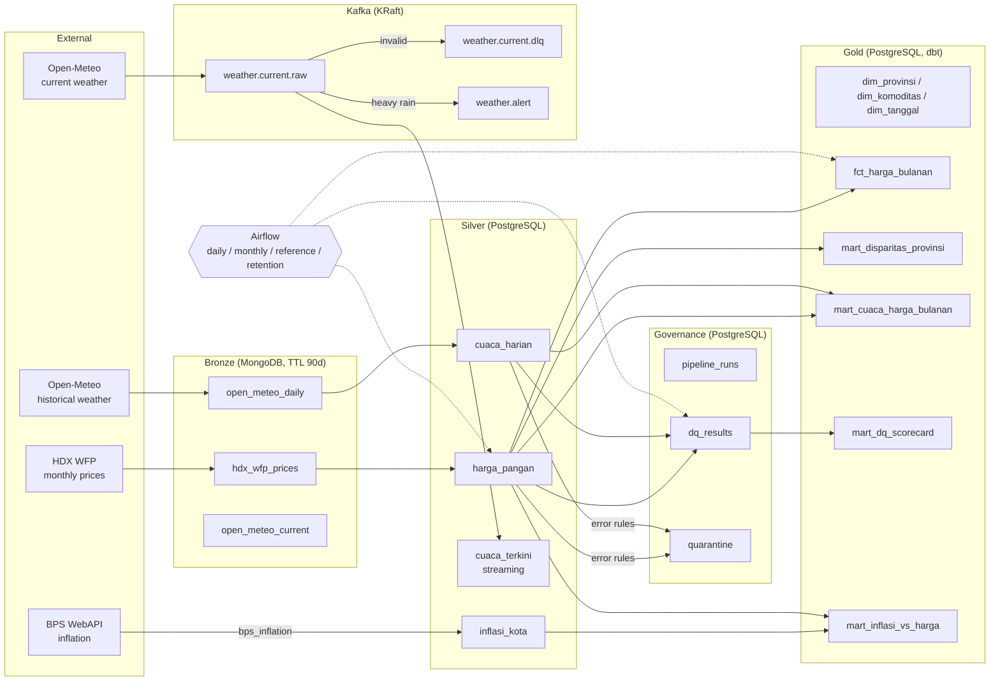

# PanganWatch

> **Summary:** A governed food-price and weather data platform showing Data Management & Analytics practice: batch + streaming pipelines, a DAMA-mapped data quality engine, metadata/lineage/ownership, Airflow orchestration, and an analytics report. Price data comes from HDX WFP (monthly, 34 of 38 provinces), so coverage and source limitations are documented honestly in the *Limitations* section. All numbers below are computed from the project database.

## 1. Business problem

PanganWatch answers three questions:

1. Which provinces' staple-food prices deviate most from the national median, and how do they trend?
2. Do months with heavy rain in a province precede a rise in **shallot/garlic (bawang)** prices within 0–4 months? (Reported as correlation, **not** causation. Chili could not be tested: the source has no chili rows in the data window.)
3. How trustworthy is each source? (Data-quality score per source and per DAMA dimension, over time.)

## 2. Key findings

#### 1. Largest price disparity: shallots, chicken eggs, and chicken meat — consistently in Maluku Utara and Sumatera Barat

`disparity.py` (last 3 available months, Apr–Jun 2026, 808 mart rows, 34 provinces) shows the largest average deviation from the national median:

| Commodity | Province | Average deviation | Cross-province CV (per month) |
|---|---|---|---|
| shallot / bawang merah (0104) | Maluku Utara (82) | +51.45% | 17.52% |
| garlic / bawang putih (0105) | Maluku Utara (82) | +47.73% | 16.54% |
| chicken egg / telur ayam (0107) | Maluku Utara (82) | +44.52% | 12.85% |
| chicken meat / daging ayam (0111) | Sumatera Barat (13) | +32.42% | 14.66% |
| rice / beras (0101) | Sumatera Barat (13) | +21.32% | 8.58% |

Sugar / gula pasir (0109) is the most uniform across provinces (CV 4.76%). Note: only 3 monthly observations per province, and **chili is absent from the data** (see finding 5), so no claim can be made about "chili".

#### 2. Heavy rain shows no relationship with shallot prices distinguishable from chance

`weather_price_lag.py` (2,490 rows of `mart_cuaca_harga_bulanan`, 34 provinces, 2025-06 through 2026-06; groups: shallot, rice, meat, sugar, oil, egg):

- Of 144 province×group×lag combinations tested, **6 (4.2%)** have p < 0.1. Under the null hypothesis, ~14.4 combinations (10% × 144) would clear that threshold by chance alone — so 6 is not evidence of a relationship.
- Strongest: Kalimantan Selatan (63), shallot, 3-month lag, Spearman ρ = −0.8281 (p = 0.0418, **n = 6** — very small).
- Pooled across all provinces, shallot: lag 1 ρ = 0.0028 (p = 0.957, n = 381); lag 2 ρ = 0.1012 (p = 0.0596, n = 347); lag 3 ρ = −0.0426 (p = 0.453, n = 313); lag 4 ρ = −0.0654 (p = 0.276, n = 279).
- Average heavy-rain days per province-month are only 0.14–0.16 (`x_mean` in `weather_price_lag_overall.csv`; very low variation).

This is **correlation, not causation**; confounders: harvest season, holidays, import policy, logistics, regional variation. Only shallot could be tested (not chili).

#### 3. Data quality: the real problem is coverage, not values

The DQ engine was run against all of `silver.harga_pangan` (20,864 rows) and `silver.cuaca_harian` (≥17,708 rows): **0 records quarantined**, every value rule (not_null, range, referential, uniqueness, tmin ≤ tmax) passes 100%. The `warn`-severity coverage rules found issues (every figure checked with a separate query):

- `HP-014` (38-province coverage per month) **fails on all 13 months**: only 34/38 = **89.47%** of provinces have prices.
- `HP-012` (≥80% of provinces for rice/shallot) fails in one month: **2026-01-15**, only 8 provinces and 350 rows (other months have 33–34 provinces, 1,660–1,719 rows); **88 rows** of rice+shallot are flagged (exact match with a direct `count(*)`).
- The old coverage rules passed vacuously due to a bug (counting rows, using a fake commodity id) — fixed, DEC-036, `incident_log.md` Incident 4.

#### 4. The DQ score history records a since-fixed CH-007 rule incident

Run `5cdd640c-…` in `governance.dq_results`: 17,708 of 141,664 row-checks failed (**12.50%**), entirely from one rule (CH-007, tmin ≤ tmax; 0 failures on any other rule). The cause was an implementation bug (a virtual column `tmin_tmax_order` that didn't exist), not bad data: `SELECT count(*) FROM silver.cuaca_harian WHERE tmin_c > tmax_c` = 0. After the fix, CH-007 fails 0 of 17,708. See `docs/governance/incident_log.md` Incident 1.

#### 5. Data coverage: 34 of 38 provinces, 8 of 14 commodities, one nearly-empty month

- **Provinces:** 34 of 38. No price data for: Papua Selatan (93), Papua Tengah (94), Papua Pegunungan (95), Papua Barat Daya (96) — provinces created by the 2022 split that don't appear in HDX WFP (the raw file only has 34 `admin1` names). `dim_provinsi.csv` has 38. The national median is the median of 34 provinces.
- **Commodities:** only 8 of 14 reference commodities have prices (rice, shallot, garlic, beef, chicken egg, cooking oil, sugar, chicken meat). **Chili (3 varieties) is absent**: HDX WFP's chili rows stop on 2024-05-15, zero rows in the 2025-06..2026-06 window.
- **Time:** January 2026 in the source is already partial (346 raw rows, 8 provinces, vs. ~1,700 rows in other months); those 8 provinces are Bali, Jawa Tengah, Jawa Timur, Kalimantan Timur, Papua, Papua Barat, Sumatera Barat, and Sumatera Utara.
- Impact: month-over-month comparisons involving January 2026 are not on equal footing; business question 2 can only be answered for shallots.

#### 6. City inflation (BPS) vs. food price change: a weak, positive, month-to-month unstable correlation

`inflation_food.py` combines `mart_inflasi_vs_harga` (monthly BPS IHK per city, mapped to province via `ref_ihk_kota`: 150/150 cities -> 38 provinces) with the HDX WFP food-price change (average of 8 commodities, vs. the previous calendar month). City inflation is averaged to province×month to avoid pseudo-replication:

- Pooled province×month: Spearman ρ = 0.206 (n = 354, p = 9.4e-05); excluding Jan–Feb 2026: ρ = 0.209 (n = 338, p = 0.000111).
- National monthly average series: ρ = 0.308 (n = 12, p = 0.33 — not significant).
- Monthly cross-sections: ρ ranges from −0.37 to +0.64; only 4 of 12 months have p < 0.05, with a mixed sign (2025-09 −0.37; 2025-10 +0.64; 2025-11 +0.44; 2026-03 +0.36).
- Level: the unweighted average year-on-year inflation across 150 cities is 1.57% (Dec 2024) -> 3.18% (Dec 2025) -> 3.42% (Aug 2026); 9 cities exceed 5% in Aug 2026 (highest: Kab. Kapuas 6.20%, Kota Ternate 5.75%).

This is **correlation, not causation**. Limitations: food prices cover only 8 commodities and only 2025-06 through 2026-06 (Jan–Feb 2026 has only 8 provinces), whereas the IHK covers the whole consumption basket; the 4 newly split Papua provinces (93–96) have IHK cities but no price data. Month-over-month inflation is derived from consecutive IHK values (BPS provides no M-to-M series for the 150 cities), and is NULL when the previous month is missing. Confounders: harvest season, holidays, fuel prices, policy.

Findings are copied verbatim (in Indonesian) from [`docs/findings.md`](docs/findings.md) by `scripts/sync_readme.py`. Full report: [`reports/panganwatch_report.html`](reports/panganwatch_report.html) (6 Plotly charts); BI exports: [`exports/tableau/`](exports/tableau/) with the [Tableau guide](docs/TABLEAU_GUIDE.md).

## 3. Architecture



More detail (batch flow, streaming flow, governance layer): [`docs/architecture.md`](docs/architecture.md), [`docs/streaming.md`](docs/streaming.md).

## 4. Tech stack and rationale

| Component | Choice | Why |
|-----------|--------|-----|
| Bronze storage | MongoDB 7 | Schema-free envelopes for raw API payloads, TTL index for lifecycle (AD-01, AD-04) |
| Silver/gold storage | PostgreSQL 16 | Relational integrity, dbt, SQL analytics |
| Transform | dbt-core + dbt-postgres | Tested SQL, lineage from `manifest.json` (AD-05) |
| DQ engine | Python + YAML catalog | Explicit rules mapped to DAMA dimensions, quarantine table |
| Streaming | Apache Kafka (KRaft) | Message contracts (Pydantic → JSON Schema), DLQ topic, alert topic (AD-08..AD-11) |
| Orchestration | Apache Airflow 2.9 (LocalExecutor) | Retries, scheduling, failure logging (AD-12) |
| Analytics | pandas, scipy, Plotly | Spearman correlation, standalone HTML report |
| Tooling | uv, ruff, pytest, GitHub Actions | Reproducible locks, lint, offline tests |

Every non-obvious choice, bug found, and verification result is logged in [`CHANGELOG.md`](CHANGELOG.md).

## 5. Job description mapping

| JD requirement | Artifact |
|----------------|----------|
| Data governance: ownership | [`governance_raci.csv`](dbt/panganwatch/seeds/governance_raci.csv), [`raci.md`](docs/governance/raci.md) |
| Data quality | [`dq_rules.yml`](config/dq_rules.yml), [`src/panganwatch/dq/`](src/panganwatch/dq/), `governance.dq_results`, `mart_dq_scorecard` |
| Metadata | dbt docs, [`data_dictionary.md`](docs/data_dictionary.md), [`glossary.md`](docs/governance/glossary.md) |
| Lineage | `_meta` envelope, [`lineage.md`](docs/lineage.md) |
| Master & reference data | `ref_provinsi`, `ref_komoditas`, `ref_crosswalk_wilayah`, [`crosswalk_report.md`](docs/governance/crosswalk_report.md) |
| Lifecycle controls | MongoDB TTL, retention DAG, [`retention_policy.md`](docs/governance/retention_policy.md) |
| DAMA-based practices | [`dama_mapping.md`](docs/governance/dama_mapping.md) |
| Python & SQL | [`src/panganwatch/`](src/panganwatch/), dbt models |
| Relational & NoSQL, fit-for-purpose | PostgreSQL (silver/gold) vs MongoDB (bronze) |
| Performance | Indexes, incremental materialization, container memory limits |
| Batch pipeline | Airflow DAGs `panganwatch_daily`, `panganwatch_monthly_bps` |
| Streaming & Kafka | [`src/panganwatch/stream/`](src/panganwatch/stream/), [`contracts/`](contracts/), [`streaming.md`](docs/streaming.md) |
| Orchestration | Airflow (AD-12) |
| Analytics & BI | [`panganwatch_report.html`](reports/panganwatch_report.html), [`exports/tableau/`](exports/tableau/), [`TABLEAU_GUIDE.md`](docs/TABLEAU_GUIDE.md) |
| Monitoring & resolving data issues | `governance.pipeline_runs`, quarantine, [`incident_log.md`](docs/governance/incident_log.md) |
| Collaboration & data standards | Glossary, RACI, [`CHANGELOG.md`](CHANGELOG.md) |

## 6. Quick start

```bash
make setup        # install Python dependencies via uv
make up           # start the Docker Compose stack
make verify       # runs: uv run python scripts/verify.py --phase all
```

Without `make` (e.g. Windows shell): `uv sync`, `docker compose up -d`, `uv run python scripts/verify.py --phase all`.
Regenerate outputs: `make report`, `make export`, `make docs`, `make versions`, `uv run python scripts/sync_readme.py`.

Services: Airflow UI <http://localhost:8080> (user `admin`; `airflow standalone` generates the password on first start — read it from the first-start container logs, or reset it with `docker compose exec airflow airflow users reset-password -u admin`), PostgreSQL `localhost:5433`, MongoDB `localhost:27017`, Kafka `localhost:9092`. Secrets live only in `.env` (see `.env.example`).

## 7. Data governance

- **Glossary** (17 terms): [`docs/governance/glossary.md`](docs/governance/glossary.md)
- **RACI matrix** (28 datasets, institutional owners): [`docs/governance/raci.md`](docs/governance/raci.md)
- **DQ rules** (27 rules, all 6 DAMA dimensions): [`docs/governance/dq_rules.md`](docs/governance/dq_rules.md)
- **Lineage** (Mermaid, from the dbt manifest): [`docs/lineage.md`](docs/lineage.md)
- **Data dictionary**: [`docs/data_dictionary.md`](docs/data_dictionary.md)
- **Retention policy** (MongoDB 90 d, quarantine 180 d, Kafka 7 d): [`docs/governance/retention_policy.md`](docs/governance/retention_policy.md)
- **Incident log** (4 incidents, incl. the only real data-quality finding: province/commodity/month coverage): [`docs/governance/incident_log.md`](docs/governance/incident_log.md)
- **DAMA mapping** (11 knowledge areas, honest coverage): [`docs/governance/dama_mapping.md`](docs/governance/dama_mapping.md)

The repo root holds only product code and top-level docs. Verification
results for each build phase are recorded in
[`CHANGELOG.md`](CHANGELOG.md); remaining manual/human tasks are
in [`docs/handover.md`](docs/handover.md).

## 8. Limitations (honest)

- **Price data covers 34 of 38 provinces** (Papua Selatan, Tengah, Pegunungan, Barat Daya are absent from HDX WFP), so the "national median" is a 34-province median. **January 2026 has only 8 provinces** in the source. DQ rules `HP-012`/`HP-014` flag both; nothing was imputed.
- **Only 8 of 14 reference commodities have prices; chili has none** in the 2025-06..2026-06 window (HDX WFP stops carrying chili in 2024-05). Question 2 can only be answered for shallots/garlic.
- **Correlation ≠ causation**, and the weather–price result is weak: 6 of 144 province×group×lag tests reach p < 0.1 (≈14 expected by chance), several with n < 10.
- **The DQ engine is a post-load gate** (Airflow task `dq_check`, DEC-029), not an inline pre-upsert filter: `error`-rule failures are recorded in `governance.quarantine`, but rows are not removed from silver. Today no real record fails an `error` rule (0 quarantined in full-table runs); the 8 quarantine rows come from the F4 injection test. Coverage rules are `warn` and never quarantine.
- **Price grain is monthly** (HDX WFP), not daily; "weekly CV" columns are one bucket per month (DEC-010).
- **BPS inflation is active** (DEC-039/040/041, supersedes DEC-014): 150 kab/kota IHK, 2024-01..2026-08; M-to-M is derived from consecutive IHK; food-price change exists only for 2025-07..2026-06 and the 4 new Papua provinces have IHK cities but no prices. **PIHPS/Panel Harga not used** — no usable API (DEC-009); HDX WFP used as fallback.
- **F8b (OpenMetadata) skipped**: only ~1.4 GB free memory vs. the 8 GB gate; lineage comes from the dbt manifest + Mermaid instead.
- **`panganwatch_reference` DAG cannot re-seed** while `silver.harga_pangan` holds rows (FK vs. `dbt seed` TRUNCATE, DEC-023/DEC-031); `export_bi`/`build_report` tasks in the daily DAG are skipped by design (DEC-029) — run `make export` / `make report` instead.
- **The Tableau Public workbook is not published** (needs a human account); the guide describes how.
- **Rebuild from empty volumes was not exercised** (it would destroy ~20k silver rows and is forbidden by project policy); it is a human step in [`docs/handover.md`](docs/handover.md) (DEC-037).
- **The repo has been committed and pushed to GitHub, but not yet tagged**; see [`docs/handover.md`](docs/handover.md) for the `v1.0.0` tag step.

## 9. Data sources and attribution

| Source | Data | License | Attribution |
|--------|------|---------|-------------|
| HDX WFP "Indonesia – Food Prices" | Monthly retail food prices (compiled by WFP from BPS/PIHPS Bank Indonesia) | CC BY-IGO (`license_id: cc-by-igo` in the HDX API) | [World Food Programme via HDX](https://data.humdata.org/dataset/wfp-food-prices-for-indonesia) |
| Open-Meteo | Historical & current weather, 38 province capitals | CC BY 4.0; the free API is for non-commercial use only | [Open-Meteo.com](https://open-meteo.com/) |
| cahyadsn/wilayah | Administrative region codes (Kepmendagri) | MIT (GitHub API `license: mit`) | [github.com/cahyadsn/wilayah](https://github.com/cahyadsn/wilayah) |
| BPS WebAPI | IHK and Y-on-Y inflation for 150 cities (vars 2245, 2249; requires an API key) | not verified — check BPS WebAPI terms before redistributing | [BPS](https://webapi.bps.go.id/) |
| Panel Harga Badan Pangan / PIHPS | Daily prices — **not used** (no usable API) | not verified (unused) | [panelharga.badanpangan.go.id](https://panelharga.badanpangan.go.id/) |

This repository is a portfolio project, not an official statistics product.
