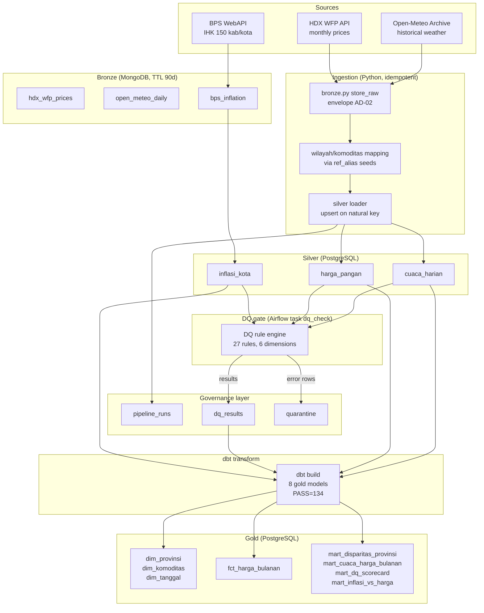
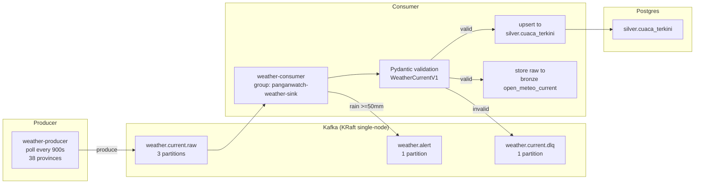
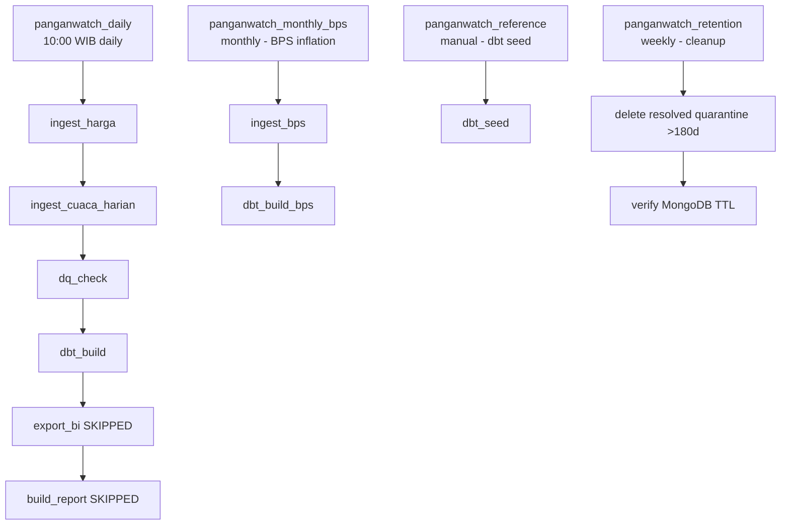

# Architecture

## Overview

PanganWatch follows a **medallion architecture** with fit-for-purpose storage:

- **Bronze** (MongoDB): Raw API payloads with `_meta` envelope (source, endpoint, hash SHA-256, run_id, fetched_at, TTL 90d).
- **Silver** (PostgreSQL): Cleaned, validated, upsert-idempotent relational tables with FK constraints.
- **Gold** (PostgreSQL, dbt): Dimensional model + analytical marts ready for BI.
- **Governance** (PostgreSQL): `pipeline_runs`, `dq_results`, `quarantine` — run-level audit trail.

---

## Batch Data Flow

### Key batch properties
- **Idempotency**: unique index `(_meta.source, _meta.payload_sha256)` in MongoDB; upsert on natural key in Postgres.
- **DQ is a post-load gate, not inline**: `DQEngine.check_records()` runs in the Airflow task `dq_check` over the whole silver tables after ingestion (DEC-029); error-severity failures are written to `governance.quarantine` and results to `governance.dq_results`, but **rows are not removed from silver**. Only the injection test (`scripts/inject_bad_records.py`) exercises the "quarantine instead of load" path. `warn` rules (e.g. province coverage `HP-014`) never quarantine.
- **Grain**: HDX WFP is monthly (one snapshot per month-day-15); marts use monthly grain (DEC-010).

---

## Streaming Data Flow

### Key streaming properties
- **Data contract**: Pydantic v2 models, JSON Schema exported to `contracts/`.
- **DLQ**: invalid messages go to `weather.current.dlq` with headers (error_reason, original_topic, original_offset, failed_at); offset committed (at-least-once, idempotent upsert).
- **Alerts**: rain >=50mm (BMKG "lebat" threshold) → `weather.alert` topic + `governance.weather_alerts` table.
- **Reconnect**: consumer has `_reconnect_postgres()` for dropped connections (DEC-032).

---

## Orchestration (Airflow)

### Airflow properties
- **4 DAGs**, all import without errors; `dags test panganwatch_daily` and `panganwatch_retention` both exit 0.
- **Failure callback**: writes `failed` status to `governance.pipeline_runs` via `dags/_common.py:write_failure_to_governance`.
- **dbt in separate venv**: `/home/airflow/dbt-venv` (DEC-030); `DBT_BIN` env var as single source of truth.
- **No secrets in DAG code**: all via `os.environ` / `panganwatch.config`.

---

## Governance Layer

| Artifact | Source | Description |
|----------|--------|-------------|
| `governance.pipeline_runs` | PostgreSQL | Run-level audit (source, started_at, status, rows) |
| `governance.dq_results` | PostgreSQL | Append-only history of per-rule results (pass_rate, rows_checked/failed); never deleted |
| `governance.quarantine` | PostgreSQL | Append-only; error-severity DQ failures with natural_key + record JSONB (currently only the 8 rows of the F4 injection test) |
| `docs/governance/glossary.md` | dbt seed (17 terms) | Business metadata |
| `docs/governance/raci.md` | dbt seed (28 datasets) | Ownership matrix with institution owners |
| `docs/governance/dq_rules.md` | `config/dq_rules.yml` (27 rules) | Rule catalog, auto-generated |
| `docs/lineage.md` | dbt `manifest.json` | Mermaid diagram, external→bronze→silver→gold |
| `docs/data_dictionary.md` | manifest + catalog | Column types, descriptions, tests, owners |
| `docs/governance/retention_policy.md` | `policies.py` generator | TTL/quarantine/silver-gold retention |
| `docs/governance/dama_mapping.md` | `policies.py` generator | 11 DAMA-DMBOK knowledge areas |
| `docs/governance/incident_log.md` | Manual | 4 documented incidents |
