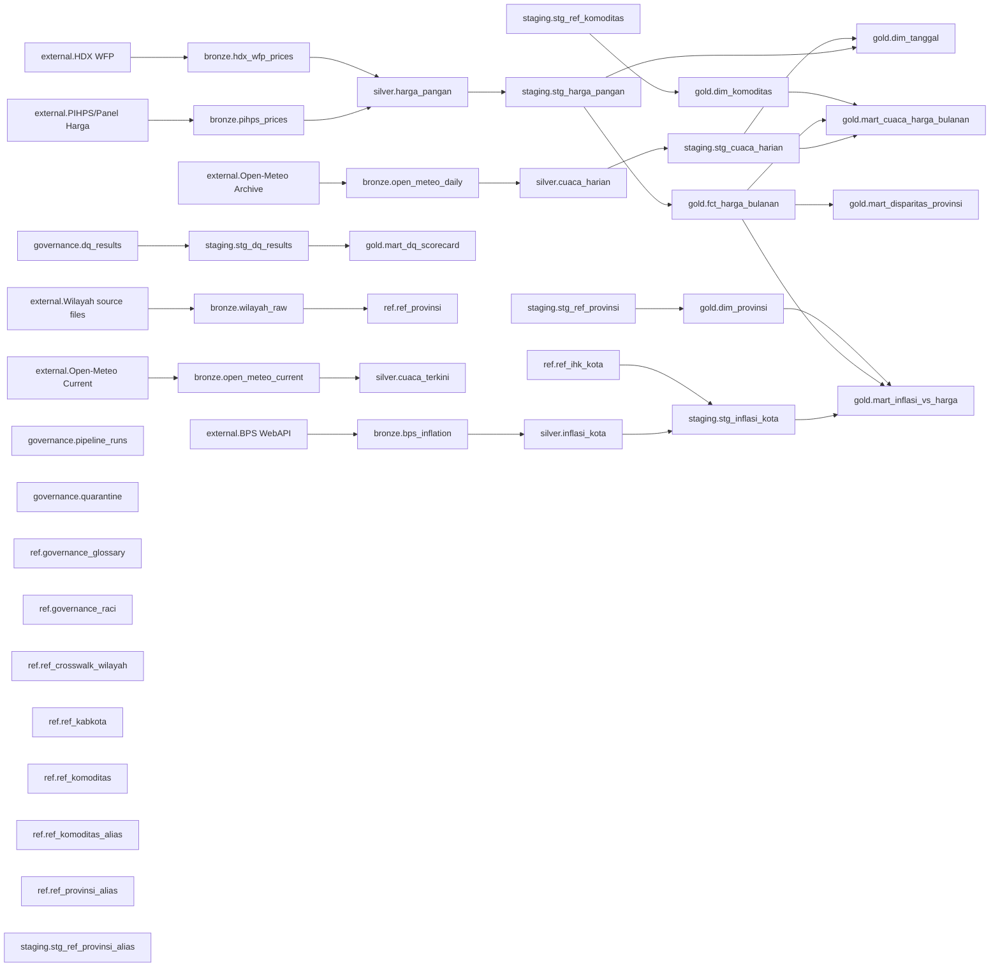

# Data Lineage

Generated from `dbt/panganwatch/target/manifest.json` plus manual external → bronze → canonical mappings.

## External Sources → Bronze → Canonical Tables

| External source | Bronze collection | Canonical table/model |
|---|---|---|
| BPS WebAPI | `bronze.bps_inflation` | `silver.inflasi_kota` |
| HDX WFP | `bronze.hdx_wfp_prices` | `silver.harga_pangan` |
| Open-Meteo Archive | `bronze.open_meteo_daily` | `silver.cuaca_harian` |
| Open-Meteo Current | `bronze.open_meteo_current` | `silver.cuaca_terkini` |
| PIHPS/Panel Harga | `bronze.pihps_prices` | `silver.harga_pangan` |
| Wilayah source files | `bronze.wilayah_raw` | `ref.ref_provinsi` |

## dbt Sources

| Source node | Relation | Description |
|---|---|---|
| `source.panganwatch.governance.dq_results` | `governance.dq_results` | Aggregated results per DQ rule per run (F4). |
| `source.panganwatch.governance.pipeline_runs` | `governance.pipeline_runs` | Execution log for every ingestion job (F1/F3). |
| `source.panganwatch.governance.quarantine` | `governance.quarantine` | Records that failed an error-severity DQ rule (F4). |
| `source.panganwatch.silver.cuaca_harian` | `silver.cuaca_harian` | Daily historical weather per province (F3c, Open-Meteo Archive). |
| `source.panganwatch.silver.harga_pangan` | `silver.harga_pangan` | Food prices per date x province x commodity x market type x source (F3a). |
| `source.panganwatch.silver.inflasi_kota` | `silver.inflasi_kota` | Monthly IHK and inflation per BPS IHK city (F3b, BPS WebAPI var 2245/2249, DEC-039). |

## Gold Model Upstream Summary

| Gold model | Materialization | Direct upstream nodes |
|---|---|---|
| `gold.dim_komoditas` | table | `staging.stg_ref_komoditas` |
| `gold.dim_provinsi` | table | `staging.stg_ref_provinsi` |
| `gold.dim_tanggal` | table | `staging.stg_cuaca_harian`, `staging.stg_harga_pangan` |
| `gold.fct_harga_bulanan` | incremental | `staging.stg_harga_pangan` |
| `gold.mart_cuaca_harga_bulanan` | table | `gold.dim_komoditas`, `gold.fct_harga_bulanan`, `staging.stg_cuaca_harian` |
| `gold.mart_disparitas_provinsi` | table | `gold.fct_harga_bulanan` |
| `gold.mart_dq_scorecard` | table | `staging.stg_dq_results` |
| `gold.mart_inflasi_vs_harga` | table | `gold.dim_provinsi`, `gold.fct_harga_bulanan`, `staging.stg_inflasi_kota` |

## Diagram Alur Data

