# Target architecture

```mermaid
flowchart LR
  A[Existing local connectors] --> B[Frozen snapshots + SHA-256 manifest]
  B --> C[UC Volume: pw_landing.snapshots]
  C --> D[Bronze Delta]
  D --> E[Typed Silver Delta + deterministic MERGE]
  E --> F[Post-load DQ: results + quarantine]
  F -->|no error failures| G[Staged then published Gold Delta]
  G --> H[Databricks SQL / AI-BI dashboard]
  I[Legacy Airflow, PostgreSQL, MongoDB, Kafka] -. preserved .-> A
```

The cloud MVP is batch only. Existing local ingestion remains the source extractor; Kafka streaming is intentionally not ported. All cloud names are configuration driven from `PANGANWATCH_CATALOG`: `pw_landing`, `pw_bronze`, `pw_silver`, `pw_gold`, and `pw_governance`.
