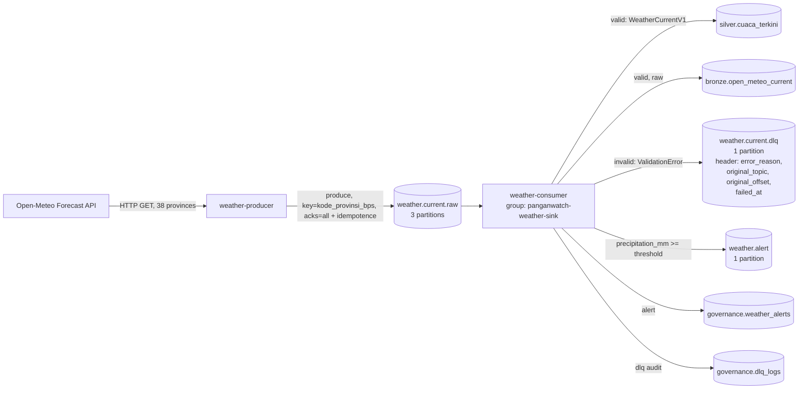

# Weather Streaming with Kafka (F6)

## Topic Flow



## Delivery Guarantees

- **Producer -> `weather.current.raw`**: `acks=all`, `enable.idempotence=True`,
  `max.in.flight.requests.per.connection=1`, `retries=5` — no message is
  lost and there is no producer-side duplication, even when a retry happens.
- **Consumer -> silver/bronze/DLQ/alert**: *at-least-once*. `enable.auto.commit=False`;
  the offset is committed manually **after** the write to Postgres/Mongo/Kafka
  succeeds (for both a valid message and an invalid one successfully sent to
  the DLQ). If the consumer crashes before committing, the same message will
  be reprocessed on restart — this is safe because:
  - `silver.cuaca_terkini` is upserted with `ON CONFLICT (kode_provinsi_bps, observed_at)` (idempotent).
  - bronze `open_meteo_current` is stored via `bronze.store_raw()` with a unique index on `(_meta.source, _meta.payload_sha256)` (AD-03) — the same payload never duplicates the document.
  - Resending the same message to the DLQ adds a row to `governance.dlq_logs` (an audit log, not state that needs to be idempotent) but does not add a silver row.
- **Invalid messages**: their offset is still **committed** once successfully
  sent to `weather.current.dlq` — they are not blocked/reprocessed forever.
  The original payload is sent unchanged, with an `error_reason` header (a
  summary of the Pydantic validation error), `original_topic`,
  `original_offset`, `failed_at`.

## Message Contracts (Appendix C)

`stream/models.py`: `WeatherCurrentV1` (topic `weather.current.raw`, key =
`kode_provinsi_bps`) and `WeatherAlertV1` (topic `weather.alert`). Their JSON
Schemas are exported to `contracts/weather_current_v1.json` and
`contracts/weather_alert_v1.json` via `make contracts`
(`stream/export_schemas.py`).

## Architecture Decision Rationale (AD-08 through AD-11)

- **AD-08 (Kafka KRaft, not Kafka+ZooKeeper or Redpanda)**: "Kafka" is
  explicitly named in the job description; KRaft removes the need for
  ZooKeeper (saves memory, uses the official `apache/kafka` image).
- **AD-09 (Pydantic v2 contracts + JSON Schema, not a Schema Registry)**: the
  DLQ and contract validation can be verified without an extra service (a
  schema registry needs an extra container and adds operational complexity
  that isn't worth it at this project's scale).
- **AD-10 (only weather is streamed, prices stay batch)**: the HDX WFP food
  price source is monthly-grain (DEC-010) — simulating streaming for data
  that isn't naturally real-time would be a contrived design. Current weather
  (the Open-Meteo forecast API) genuinely changes all the time, so streaming
  it has a real justification.
- **AD-11 (producer/consumer as long-running Docker services, not an Airflow
  task)**: Airflow (AD-12) is designed for scheduled batch work
  (start-to-finish); a streaming process needs to stay alive continuously
  (`restart: unless-stopped`), which doesn't fit Airflow's task execution
  model.

## Open-Meteo Quota

The producer's default `poll_interval_seconds=900` (15 minutes) -> 96
cycles/day x 38 provinces = 3,648 requests/day to the Open-Meteo Forecast API
— well under Open-Meteo's free usage limit (10,000 requests/day per IP, per
their official documentation, https://open-meteo.com/en/terms).

## Running It

```bash
docker compose up -d --build weather-producer weather-consumer
uv run python -m panganwatch.stream.producer --once   # 1 manual cycle (test)
uv run python scripts/send_invalid_weather.py          # send 3 malformed messages
```
